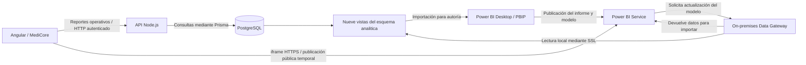

# MediCore — Análisis multidimensional OLAP

Proyecto universitario del ERP hospitalario del **Hospital Boston Vida**. Este directorio conserva el proyecto editable de Power BI en formatos **PBIP, PBIR y TMDL**, integrado en la sección **Reportes y análisis → Análisis OLAP** de Angular.

**Alcance académico:** el informe público autorizado contiene exclusivamente datos ficticios. Su publicación es temporal y su acceso no está protegido por la autenticación del ERP. No conectar datos personales reales a esta publicación.

## 1. Objetivos y alcance

El módulo permite analizar la actividad asistencial y el uso de recursos por fecha, médico, especialidad, servicio, categoría de insumo y unidad de medida. Facilita comparar citas con atenciones, explorar servicios realizados y reconocer tendencias de consumo y reposición.

El proyecto contiene **un informe con tres páginas**, **cuatro dimensiones**, **cinco tablas de hechos**, **doce relaciones**, **dieciocho medidas DAX** y la jerarquía temporal **año → trimestre → mes → día**. Las nueve tablas se importan desde las nueve vistas del esquema `analitica` de PostgreSQL.

### Reportes operativos y OLAP

| Función        | Reportes operativos                                                       | Análisis OLAP                                                                       |
| -------------- | ------------------------------------------------------------------------- | ----------------------------------------------------------------------------------- |
| Propósito      | Consultar el funcionamiento diario del hospital.                          | Explorar tendencias y apoyar decisiones mediante distintas dimensiones.             |
| Implementación | Angular consulta la API Node.js y presenta citas, servicios e inventario. | Power BI ejecuta las medidas del modelo importado y presenta el informe incrustado. |
| Filtros        | Fechas y médico según el reporte existente.                               | Segmentadores, selección de gráficos y jerarquías del informe original.             |
| Exportación    | CSV desde MediCore, con las validaciones existentes.                      | Funciones disponibles en la publicación de Power BI.                                |
| Vigencia       | Datos consultados por la API al aplicar filtros.                          | Última importación completada en Power BI; la publicación puede añadir caché.       |

## 2. Arquitectura de integración



La API atiende las operaciones del ERP. El informe incrustado se obtiene directamente de Power BI Service: no pasa por la API, no recibe su JWT y no consulta PostgreSQL desde el navegador. Desktop permite editar el modelo y las páginas; Gateway permite que Service acceda al origen local para actualizar el modelo importado.

Las vistas se definen en [la migración analítica existente](../backend/prisma/migrations/1_analitica/migration.sql). Esta entrega no modifica su SQL ni ejecuta migraciones. Las fechas de eventos se convierten a `America/Costa_Rica` en esas vistas. Se excluyen nombres y contacto de pacientes, diagnósticos y notas clínicas; `dim_medicos` sí incluye nombres de médicos, que en la demostración deben ser ficticios.

## 3. Archivos fuente y recursos

```text
powerbi/
├── MediCore_OLAP.pbip
├── MediCore_OLAP.Report/
│   ├── .platform
│   ├── definition.pbir
│   ├── definition/
│   │   ├── version.json
│   │   ├── report.json
│   │   └── pages/                 # Tres páginas y sus 41 definiciones visuales
│   └── StaticResources/SharedResources/BaseThemes/Fluent2-CY26SU10.json
├── MediCore_OLAP.SemanticModel/
│   ├── .platform
│   ├── definition.pbism
│   ├── diagramLayout.json
│   └── definition/
│       ├── database.tmdl
│       ├── model.tmdl
│       ├── relationships.tmdl
│       ├── cultures/es-CR.tmdl
│       └── tables/                # Nueve tablas, medidas y consultas Power Query
├── scripts/validar-proyecto.cjs
└── README.md
```

`MediCore_OLAP.pbip` referencia el directorio del informe y `definition.pbir` referencia el modelo mediante una ruta relativa. Se conservan `.platform`, el diseño del modelo, el tema y los JSON de los visuales. Los rótulos y la identidad del informe están definidos en sus cuadros de texto; no se detectaron imágenes externas adicionales declaradas como recursos.

Las carpetas `.pbi`, `cache.abf` y `localSettings.json` son archivos locales excluidos del control de versiones. El caché puede contener datos importados y no es necesario para distribuir la definición del proyecto. Tras clonar sin caché, es necesario conectar y actualizar para disponer de datos. Véase [proyectos PBIP](https://learn.microsoft.com/en-us/power-bi/developer/projects/projects-overview) y [archivos del modelo semántico](https://learn.microsoft.com/en-us/power-bi/developer/projects/projects-dataset).

## 4. Modelo dimensional

### Cuatro dimensiones

| Tabla y vista de origen   | Clave         | Atributos reales                                                                           | Uso                                                                              |
| ------------------------- | ------------- | ------------------------------------------------------------------------------------------ | -------------------------------------------------------------------------------- |
| `analitica.dim_fecha`     | `fecha`       | `anio`, `trimestre`, `mes`, `dia`                                                          | Calendario compartido; `fecha` está marcada como clave y la tabla como temporal. |
| `analitica.dim_medicos`   | `id_medico`   | `medico`, `especialidad`, `activo`                                                         | Análisis por médico y especialidad.                                              |
| `analitica.dim_servicios` | `id_servicio` | `codigo`, `nombre`, `activo`                                                               | Catálogo de servicios hospitalarios.                                             |
| `analitica.dim_insumos`   | `id_insumo`   | `codigo`, `nombre`, `categoria`, `unidad_medida`, `stock_actual`, `stock_minimo`, `activo` | Catálogo y existencias actuales; no constituye un histórico de stock.            |

### Cinco tablas de hechos

| Tabla y vista de origen      | Grano de cada fila                                     | Campos principales                                                                                         |
| ---------------------------- | ------------------------------------------------------ | ---------------------------------------------------------------------------------------------------------- |
| `analitica.fact_citas`       | Una cita (`id_cita`).                                  | `id_medico`, fecha de cita, `estado`, `duracion_minutos`.                                                  |
| `analitica.fact_atenciones`  | Una atención (`id_atencion`).                          | `id_cita`, `id_medico`, fecha de atención, `estado`.                                                       |
| `analitica.fact_servicios`   | Un detalle de servicio de una atención (`id_detalle`). | `id_atencion`, `id_servicio`, `id_medico`, fecha de atención, `cantidad`.                                  |
| `analitica.fact_consumos`    | Un registro de consumo en una atención (`id_consumo`). | `id_atencion`, `id_insumo`, `id_medico`, fecha de atención, `cantidad`.                                    |
| `analitica.fact_movimientos` | Un movimiento de inventario (`id_movimiento`).         | `id_insumo`, fecha de movimiento, `tipo_movimiento`, `cantidad`, `origen` (`MANUAL` o `CONSUMO_ATENCION`). |

Todas las particiones TMDL usan `mode: import` y `PostgreSQL.Database("localhost:5433", "medicore")`. Los identificadores de negocio están definidos como texto para evitar pérdida de precisión de identificadores grandes.

### Doce relaciones reales

La siguiente tabla transcribe los extremos `fromColumn` y `toColumn` de [relationships.tmdl](MediCore_OLAP.SemanticModel/definition/relationships.tmdl). El diseño conecta los hechos con sus dimensiones; no agrega relaciones entre hechos.

| N.º | Origen (`fromColumn`, hecho) | Destino (`toColumn`, dimensión) | Análisis habilitado                               |
| --- | ---------------------------- | ------------------------------- | ------------------------------------------------- |
| 1   | `fact_consumos.id_insumo`    | `dim_insumos.id_insumo`         | Consumos por insumo, categoría y unidad.          |
| 2   | `fact_movimientos.id_insumo` | `dim_insumos.id_insumo`         | Movimientos por insumo, categoría y unidad.       |
| 3   | `fact_atenciones.id_medico`  | `dim_medicos.id_medico`         | Atenciones por médico y especialidad.             |
| 4   | `fact_citas.id_medico`       | `dim_medicos.id_medico`         | Citas por médico y especialidad.                  |
| 5   | `fact_consumos.id_medico`    | `dim_medicos.id_medico`         | Consumos asistenciales por médico y especialidad. |
| 6   | `fact_servicios.id_medico`   | `dim_medicos.id_medico`         | Servicios por médico y especialidad.              |
| 7   | `fact_servicios.id_servicio` | `dim_servicios.id_servicio`     | Servicios por tipo de servicio.                   |
| 8   | `fact_citas.fecha`           | `dim_fecha.fecha`               | Citas por fecha de cita.                          |
| 9   | `fact_atenciones.fecha`      | `dim_fecha.fecha`               | Atenciones por fecha de atención.                 |
| 10  | `fact_servicios.fecha`       | `dim_fecha.fecha`               | Servicios por fecha de atención.                  |
| 11  | `fact_consumos.fecha`        | `dim_fecha.fecha`               | Consumos por fecha de atención.                   |
| 12  | `fact_movimientos.fecha`     | `dim_fecha.fecha`               | Movimientos por su propia fecha.                  |

El archivo serializa los extremos y no declara excepciones de cardinalidad, dirección o activación; se conserva sin alteraciones. Revisar esas propiedades en la vista Modelo al abrir Desktop. La estructura corresponde conceptualmente a dimensiones en el lado uno y hechos en el lado muchos. `dim_fecha` no filtra directamente `dim_insumos`, y `dim_servicios` no filtra directamente `fact_atenciones`.

## 5. Medidas DAX: definiciones reales

Las siguientes dieciocho expresiones se transcriben de `definition/tables/*.tmdl`; solo se normaliza la indentación. No se agregan ni se cambian medidas.

### Total insumos

Tabla: `dim_insumos`. Cuenta los insumos activos del contexto actual de la dimensión.

```dax
Total insumos =
CALCULATE(
    COUNTROWS(dim_insumos),
    dim_insumos[activo] = TRUE()
)
```

### Insumos por reponer

Tabla: `dim_insumos`. Cuenta insumos activos con stock actual menor o igual al mínimo; devuelve cero cuando no hay filas.

```dax
Insumos por reponer =
COUNTROWS(
    FILTER(
        dim_insumos,
        dim_insumos[activo] = TRUE() &&
        dim_insumos[stock_actual] <= dim_insumos[stock_minimo]
    )
) + 0
```

### Porcentaje reposicion

Tabla: `dim_insumos`. Razón entre insumos por reponer y total de insumos activos.

```dax
Porcentaje reposicion =
DIVIDE(
    [Insumos por reponer],
    [Total insumos],
    0
)
```

### Existencias actuales

Tabla: `dim_insumos`. Suma el stock actual solo cuando el contexto contiene una única unidad de medida.

```dax
Existencias actuales =
IF(
    HASONEVALUE(dim_insumos[unidad_medida]),
    SUM(dim_insumos[stock_actual]),
    BLANK()
)
```

### Total atenciones

Tabla: `fact_atenciones`. Cuenta filas de atenciones dentro del contexto de filtros aplicable.

```dax
Total atenciones =
COUNTROWS(fact_atenciones)
```

### Total citas

Tabla: `fact_citas`. Cuenta filas de citas dentro del contexto de filtros aplicable.

```dax
Total citas =
COUNTROWS(fact_citas)
```

### Citas atendidas

Tabla: `fact_citas`. Cuenta citas fijando el estado a ATENDIDA mediante CALCULATE.

```dax
Citas atendidas =
CALCULATE(
    [Total citas],
    fact_citas[estado] = "ATENDIDA"
)
```

### Porcentaje atendido

Tabla: `fact_citas`. Razón entre citas atendidas y total de citas del contexto.

```dax
Porcentaje atendido =
DIVIDE(
    [Citas atendidas],
    [Total citas],
    0
)
```

### Duracion promedio citas

Tabla: `fact_citas`. Promedio de la duración en minutos de las citas; no mide la duración clínica de las atenciones.

```dax
Duracion promedio citas =
AVERAGE(fact_citas[duracion_minutos])
```

### Total registros consumo

Tabla: `fact_consumos`. Cuenta registros de consumo; no suma cantidades físicas.

```dax
Total registros consumo =
COUNTROWS(fact_consumos)
```

### Consumo

Tabla: `fact_consumos`. Suma la cantidad consumida únicamente cuando hay una sola unidad de medida.

```dax
Consumo =
IF(
    HASONEVALUE(dim_insumos[unidad_medida]),
    SUM(fact_consumos[cantidad]),
    BLANK()
)
```

### Movimientos

Tabla: `fact_movimientos`. Cuenta filas de movimientos de inventario; no representa unidades físicas.

```dax
Movimientos =
COUNTROWS(fact_movimientos)
```

### Entradas inventario

Tabla: `fact_movimientos`. Cuenta movimientos cuyo tipo es ENTRADA.

```dax
Entradas inventario =
CALCULATE(
    [Movimientos],
    fact_movimientos[tipo_movimiento] = "ENTRADA"
)
```

### Salidas inventario

Tabla: `fact_movimientos`. Cuenta movimientos cuyo tipo es SALIDA.

```dax
Salidas inventario =
CALCULATE(
    [Movimientos],
    fact_movimientos[tipo_movimiento] = "SALIDA"
)
```

### Cantidad entradas

Tabla: `fact_movimientos`. Suma cantidades de entradas solo cuando hay una única unidad de medida.

```dax
Cantidad entradas =
IF(
    HASONEVALUE(dim_insumos[unidad_medida]),
    CALCULATE(
        SUM(fact_movimientos[cantidad]),
        fact_movimientos[tipo_movimiento] = "ENTRADA"
    ),
    BLANK()
)
```

### Cantidad salidas

Tabla: `fact_movimientos`. Suma cantidades de salidas solo cuando hay una única unidad de medida.

```dax
Cantidad salidas =
IF(
    HASONEVALUE(dim_insumos[unidad_medida]),
    CALCULATE(
        SUM(fact_movimientos[cantidad]),
        fact_movimientos[tipo_movimiento] = "SALIDA"
    ),
    BLANK()
)
```

### Servicios realizados

Tabla: `fact_servicios`. Suma la cantidad de los detalles de servicios; no cuenta filas de atenciones.

```dax
Servicios realizados =
SUM(fact_servicios[cantidad])
```

### Promedio servicios

Tabla: `fact_servicios`. Divide servicios realizados entre total de atenciones y devuelve cero si el denominador es cero.

```dax
Promedio servicios =
DIVIDE(
    [Servicios realizados],
    [Total atenciones],
    0
)
```

### Consideraciones de interpretación

- Los conteos de movimientos y registros de consumo no equivalen a cantidades físicas.
- `Consumo`, `Cantidad entradas`, `Cantidad salidas` y `Existencias actuales` devuelven `BLANK()` cuando no existe una única unidad de medida en el contexto. No sumar mililitros, unidades u otras magnitudes incompatibles.
- `Insumos por reponer` usa `stock_actual <= stock_minimo` y solo insumos activos; el `+ 0` representa un resultado vacío como cero. El stock describe el último estado importado de la dimensión, no el estado histórico del período seleccionado.
- Los cocientes con `DIVIDE(..., 0)` devuelven cero si el denominador es cero. Las medidas de porcentaje son razones; no multiplicarlas nuevamente por cien cuando se formateen como porcentaje.
- `Citas atendidas` fija el filtro de `fact_citas[estado]` a `ATENDIDA` mediante `CALCULATE`; no usa `KEEPFILTERS`.
- El denominador de `Promedio servicios` es el total de atenciones del contexto compartido de fecha y médico, no únicamente atenciones con el servicio seleccionado. En la página de servicios se conservan además las interacciones `NoFilter` hacia las tarjetas de atenciones y promedio para evitar que un servicio altere esas tarjetas.

## 6. Jerarquía temporal y operaciones OLAP

La jerarquía existente se llama **`dim_fecha[Jerarquíatemporal]`** y contiene, en orden, `anio`, `trimestre`, `mes` y `dia`. La vista de calendario genera días entre los extremos de las fechas de citas, atenciones y movimientos; no utiliza un calendario fijo inventado.

| Operación      | Aplicación en el informe                                                                                                                                         |
| -------------- | ---------------------------------------------------------------------------------------------------------------------------------------------------------------- |
| **Drill-down** | Descender de año a trimestre, mes y día en los gráficos temporales que usan la jerarquía. Seleccionar primero el visual y utilizar sus controles de exploración. |
| **Roll-up**    | Subir del detalle diario a mes, trimestre o año para ver agregados.                                                                                              |
| **Slice**      | Fijar un valor de una dimensión: por ejemplo, un médico o una unidad de medida mediante el segmentador correspondiente.                                          |
| **Dice**       | Combinar filtros: por ejemplo, período, médico y especialidad; o período, categoría, insumo y unidad en inventario.                                              |

Las posibilidades dependen de las relaciones y de las interacciones de cada página. No todas las dimensiones filtran todas las tablas: movimientos no tiene relación con médicos y las existencias actuales no responden a fechas de hechos.

## 7. Páginas del informe

| Página                      | Contenido inspeccionado en PBIR                                                                                                                                                            | Segmentadores                                  |
| --------------------------- | ------------------------------------------------------------------------------------------------------------------------------------------------------------------------------------------ | ---------------------------------------------- |
| **Citas y atenciones**      | 12 visuales: tarjetas de citas, citas atendidas, porcentaje y atenciones; comparación por médico; distribución por estado; evolución temporal y cuadros de texto.                          | Período, médico y especialidad.                |
| **Servicios hospitalarios** | 14 visuales: servicios realizados, total de atenciones, promedio; servicios por tipo, médico y especialidad; evolución temporal y aclaraciones de contexto.                                | Período, médico, especialidad y servicio.      |
| **Inventario e insumos**    | 15 visuales: insumos activos, insumos por reponer, entradas y salidas como conteos; consumo físico por unidad, evolución de movimientos, movimientos por categoría y tabla de existencias. | Período, categoría, insumo y unidad de medida. |

Se preservan las 41 definiciones visuales, los filtros y las interacciones originales. En inventario, las interacciones que no deben alterar el estado actual están marcadas `NoFilter` hacia los visuales correspondientes. El informe abre inicialmente la página **Servicios hospitalarios**, según `pages.json`.

## 8. Abrir el proyecto y conectar PostgreSQL

1. Clonar el repositorio y usar una versión de Power BI Desktop para Windows compatible con las versiones PBIP/PBIR/TMDL incluidas. Si Desktop solicita habilitar una característica del formato, seguir la documentación de esa versión. No convertir ni sobrescribir los originales sin revisar el diff.
2. Abrir **`powerbi/MediCore_OLAP.pbip`**. Mantener juntos los directorios `.Report` y `.SemanticModel` para conservar sus referencias relativas.
3. Confirmar que la instalación local de PostgreSQL dispone de la base y las nueve vistas `analitica`. Usar el procedimiento de instalación del [backend](../backend/README.org); no copiar un directorio de datos de PostgreSQL al repositorio.
4. Revisar el origen en **Transformar datos → Configuración de origen de datos**. Los parámetros de referencia del equipo son:

   | Parámetro                          | Referencia       |
   | ---------------------------------- | ---------------- |
   | Servidor                           | `localhost`      |
   | Puerto                             | `5433`           |
   | Valor servidor:puerto del conector | `localhost:5433` |
   | Base de datos                      | `medicore`       |
   | Usuario de lectura                 | `medicore_bi`    |
   | Esquema                            | `analitica`      |
   | Modo                               | Importación      |

5. **El puerto puede variar según la instalación de cada integrante.** `5432` u otro puerto del backend no implica que el informe de referencia use ese mismo puerto. Adaptar coherentemente las nueve consultas y la conexión del Gateway cuando se prepare otra instalación; esta revisión conserva el modelo original.
6. Elegir autenticación de base de datos e introducir la contraseña del usuario de lectura únicamente en el gestor de credenciales de Desktop/Gateway. El administrador debe comprobar permisos mínimos de conexión, uso del esquema y lectura de las vistas. No utilizar una cuenta administrativa como origen del informe.
7. Actualizar desde Desktop y verificar las tres páginas. Si el proyecto se abrió sin `cache.abf`, la definición estará disponible, pero los datos deberán importarse desde PostgreSQL.

Las versiones actuales del conector incluyen su proveedor; comprobar los requisitos de la versión instalada antes de instalar controladores adicionales. Referencia: [conector PostgreSQL de Power Query](https://learn.microsoft.com/en-us/power-query/connectors/postgresql).

### SSL y certificados de confianza

La instalación académica declara configurada la conexión SSL. El TMDL solo describe servidor, base y vistas: **no prueba por sí mismo** el cifrado ni la confianza del certificado de una sesión activa.

El servidor debe presentar un certificado vigente, con cadena de confianza válida y un nombre compatible con el servidor utilizado por el cliente. Desktop y la máquina del Gateway deben confiar en la autoridad emisora según el conector y su cuenta de servicio. Distribuir únicamente certificados públicos por un canal apropiado cuando se necesiten; conservar las claves privadas en el servidor. No resolver fallos desactivando la validación del certificado ni guardando claves privadas en el proyecto.

Si Gateway está en otra máquina, `localhost` apunta a esa máquina, no al equipo del autor: utilizar un nombre de servidor alcanzable y coherente con su certificado y con la configuración del modelo. Comprobar el cifrado de una sesión autorizada en el servidor y el funcionamiento de la conexión desde cada cliente. Referencias: [conector PostgreSQL](https://learn.microsoft.com/en-us/power-query/connectors/postgresql) y [verificación SSL de PostgreSQL](https://www.postgresql.org/docs/current/libpq-ssl.html).

## 9. Gateway y actualización de datos

### Configuración de referencia

1. Instalar On-premises Data Gateway en un equipo Windows que alcance PostgreSQL; registrar el Gateway con la cuenta institucional correspondiente. Custodiar su clave de recuperación fuera del repositorio. Para otra instalación, seguir [la guía oficial del Gateway](https://learn.microsoft.com/en-us/data-integration/gateway/service-gateway-install).
2. En Service, entrar a **Configuración → Administrar conexiones y puertas de enlace**, crear o revisar el origen PostgreSQL y asociarlo al Gateway. Configurar la autenticación del usuario de lectura y la confianza SSL.
3. Mantener idénticos el servidor y la base entre Desktop y la conexión del Gateway. Asociar el modelo publicado a esa conexión desde su configuración. Véase [administración de orígenes del Gateway](https://learn.microsoft.com/en-us/power-bi/connect-data/service-gateway-data-sources).
4. Probar la conexión y usar **Actualizar ahora** en el modelo semántico. Revisar el historial para comprobar el resultado de la importación, no solo que el navegador muestra una página.

**La computadora que aloja PostgreSQL y Gateway debe permanecer encendida, sin suspensión, con los servicios iniciados y conexión a Internet.** Si se alojan en equipos distintos, ambos deben estar disponibles. La página pública puede seguir mostrando datos previamente importados aunque el origen esté apagado; verla no demuestra que Gateway esté disponible.

### Ocho horarios diarios configurados

Zona horaria de referencia: **Costa Rica (`America/Costa_Rica`, UTC−6)**.

| Formato de 24 horas | Hora local  |
| ------------------- | ----------- |
| 07:00               | 7:00 a. m.  |
| 09:00               | 9:00 a. m.  |
| 11:00               | 11:00 a. m. |
| 13:00               | 1:00 p. m.  |
| 15:00               | 3:00 p. m.  |
| 17:00               | 5:00 p. m.  |
| 19:00               | 7:00 p. m.  |
| 21:00               | 9:00 p. m.  |

La programación se administra en Power BI Service y no se incluye en PBIP como evidencia de ejecución. Esta entrega la documenta y **no modifica sus horarios**. Seleccionar en Service la zona que corresponda a UTC−6/Costa Rica; los inicios pueden sufrir demoras del servicio. Referencia: [actualización programada](https://learn.microsoft.com/en-us/power-bi/connect-data/refresh-scheduled-refresh).

**Estado declarado por el equipo:** la actualización manual fue comprobada; **la ejecución programada todavía requiere verificación**. Antes de la exposición, revisar el historial después de los horarios previstos y guardar evidencia de inicio, finalización y resultado sin mostrar credenciales. No confundir una programación guardada con una actualización ejecutada correctamente.

## 10. Integración con Angular

La única configuración del enlace publicado está en [configuracion-powerbi.ts](../frontend/src/aplicacion/nucleo/configuracion-powerbi.ts), constante `POWER_BI_CONFIG.reportUrl`. Se conserva el enlace académico autorizado aportado por el equipo; no se reproduce en este README ni en otro archivo de configuración.

El componente [reportes.ts](../frontend/src/aplicacion/modulos/reportes/reportes.ts) valida HTTPS, el dominio exacto `app.powerbi.com`, la ruta `/view`, un único parámetro `r` con formato permitido y la ausencia de credenciales, fragmento o puerto no estándar. Solo después usa `DomSanitizer.bypassSecurityTrustResourceUrl` para el `src` del iframe de [reportes.html](../frontend/src/aplicacion/modulos/reportes/reportes.html).

Se conservan los tres reportes operativos, sus filtros, consultas y CSV. La sección OLAP no recrea gráficos en Angular: presenta el informe original y permite navegar por sus tres páginas. Incluye apertura externa con `noopener noreferrer`, pantalla completa, recarga de visualización, indicador de carga, ayuda ante fallos y diseño adaptable en [reportes.css](../frontend/src/aplicacion/modulos/reportes/reportes.css). Cambiar de categoría mantiene la instancia del iframe; recargarla puede restablecer su navegación y filtros.

El evento `load` del iframe no confirma que todos los gráficos hayan cargado ni permite verificar el estado del Gateway. El indicador describe una conexión configurada, con estado no verificado. **Recargar el iframe no actualiza PostgreSQL ni fuerza la actualización del modelo semántico.**

## 11. Seguridad y distribución académica

- El repositorio distribuye definiciones, no credenciales. Se conservan `.env.example` y los archivos fuente. `.gitignore` excluye `.env`, `.pbi`, cachés, claves, certificados locales, temporales, dependencias y directorios o respaldos de datos PostgreSQL.
- Las contraseñas de demo se obtienen de variables locales `DEMO_ADMIN_PASSWORD`, `DEMO_ADMISION_PASSWORD`, `DEMO_MEDICO_PASSWORD` y `DEMO_INVENTARIO_PASSWORD`. No se publican valores predeterminados ni se cambian cuentas existentes al preparar esta entrega. Los ejemplos HTTP piden la contraseña y obtienen el JWT de la respuesta de login.
- Los valores simulados dentro de pruebas aisladas no son credenciales de conexión. Las semillas y sus contactos corresponden al entorno ficticio. La revisión estática no certifica el contenido de una base local, el historial remoto ni futuros datos importados.
- No publicar capturas con credenciales, claves de recuperación del Gateway ni datos reales. No añadir `PGDATA`, bases copiadas, volcados o el caché ABF para facilitar la ejecución.
- Los JWT literales hallados en los ejemplos se retiraron del árbol de trabajo. `.gitignore` no elimina archivos ya seguidos ni borra el historial. Si un secreto reutilizado estuvo en commits anteriores, debe revocarse o rotarse; no se reescribe el historial automáticamente.

**Publicar en la web no requiere autenticación y puede exponer datos subyacentes del modelo.** La sesión de MediCore solo protege las rutas propias del ERP. La disponibilidad y el caché de la publicación dependen de Power BI Service; este acceso temporal no es apropiado para un ERP hospitalario con datos reales. Referencia: [publicación web de Power BI](https://learn.microsoft.com/en-us/power-bi/collaborate-share/service-publish-to-web).

### Revocar el enlace después de la presentación

1. El propietario entra a Power BI Service y al área de trabajo del informe.
2. Abre **Configuración → Administrar códigos de inserción** y localiza el código público de `MediCore_OLAP`.
3. Elimina ese código y confirma la revocación. Comprueba el enlace en una ventana privada: debe dejar de permitir el acceso.
4. Vacía `POWER_BI_CONFIG.reportUrl` en Angular. Se mostrará el mensaje de informe no disponible y seguirán funcionando los reportes operativos.

Quitar el iframe o cerrar la sesión del ERP no revoca el código público. Eliminarlo tampoco recupera copias que alguien ya haya descargado. Este procedimiento se documenta para después de la exposición; no se ejecuta en esta entrega. Véase [gestión de códigos de inserción](https://learn.microsoft.com/en-us/power-bi/collaborate-share/service-publish-to-web#manage-embed-codes).

## 12. Validación reproducible y pendientes

Desde la raíz del repositorio:

```sh
node powerbi/scripts/validar-proyecto.cjs
```

Sin dependencias adicionales ni acceso a la base, el validador comprueba sintaxis de los 54 archivos de formato JSON distribuibles (`.json`, `.pbip`, `.pbir`, `.pbism`, `.platform`), referencias de proyecto y recursos, nueve tablas, doce relaciones, dieciocho medidas, jerarquía, tres páginas y referencias a columnas/medidas de sus visuales. También contrasta los nombres de las vistas y las fórmulas documentadas. Omite los archivos locales `.pbi`.

**Límite:** es una validación estática; no sustituye la validación de esquemas oficiales, el motor TMDL/DAX, una importación real ni la comprobación de Service/Gateway.

```sh
cd frontend
npm run build
npm test -- --watch=false
```

```sh
cd backend
npm test
node --test tests/credenciales-demo.test.js
```

Las pruebas de credenciales de demo usan un cliente simulado y no siembran ni consultan una base. Las pruebas de integración que crean bases de prueba no forman parte de estos comandos y requieren preparar explícitamente su entorno.

Antes de subir: revisar `git status --short --untracked-files=all`, `git diff --check` y las exclusiones con `git check-ignore`. Antes de exponer: abrir el PBIP en Desktop, actualizar con el usuario de lectura, revisar relaciones y las tres páginas, verificar SSL y guardar evidencia de la programación realmente ejecutada. Tras presentar: revocar el enlace público.

No se realiza commit, push, merge, cambio a `main`, modificación de migraciones ni publicación en Service como parte de esta preparación.

### Resultado de la revisión del 25 de noviembre de 2026

| Comprobación                         | Resultado                                                                                                                                                                   |
| ------------------------------------ | --------------------------------------------------------------------------------------------------------------------------------------------------------------------------- |
| Compilación de producción de Angular | Correcta, sin errores ni advertencias.                                                                                                                                      |
| Pruebas de Angular                   | 65 aprobadas en 9 archivos; incluyen navegación, permisos, filtros, CSV y visor OLAP.                                                                                       |
| Pruebas de validación del backend    | 2 aprobadas.                                                                                                                                                                |
| Pruebas de credenciales de demo      | 3 aprobadas con cliente simulado, sin base de datos.                                                                                                                        |
| JSON y estructura PBIP/PBIR/TMDL     | 54 archivos de formato JSON legibles; 9 tablas, 12 relaciones, 18 medidas, jerarquía y 3 páginas con 41 visuales.                                                           |
| Integridad del proyecto aportado     | Los 71 archivos originales conservan su hash SHA-256; 4 archivos de `.pbi` quedan locales e ignorados. Se distribuyen 67 fuentes originales más este README y el validador. |
| Integración de Angular               | Se conserva el componente, iframe, URL autorizada, pantalla completa, apertura externa, validación y estilos adaptables. No se cambió la lógica del módulo.                 |

Se corrigieron dos casos de prueba de agenda que dejaban de cambiar la fecha cuando el día actual coincidía con una fecha fija. El ajuste solo afecta al archivo de pruebas. La revisión de seguridad también retiró contraseñas de demo reutilizadas en fixtures HTTP simulados; las pruebas ya no dependen de esas credenciales locales.

**Pendientes antes de cerrar la entrega:** comprobar la ejecución programada real en Service y la conexión SSL/Gateway en su entorno; abrir el PBIP y actualizarlo en Desktop; revisar si los secretos antiguos se reutilizaron y requieren rotación por aparecer en el historial; actualizar [la evidencia de reportes](../docs/evidencias/reportes-desktop.png), que todavía muestra la interfaz anterior a la integración del iframe. La revisión visual de las capturas existentes corresponde a datos de prueba y no mostró credenciales.
